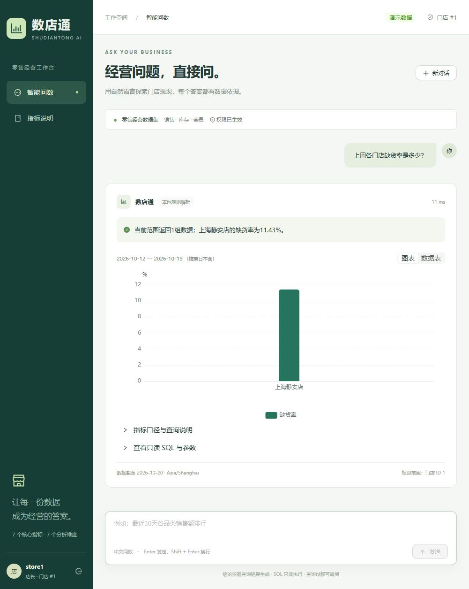

# MVP 验收记录

验收日期：2026-10-21（Asia/Shanghai）。执行环境：Windows、Python 3.11.16、Node 24.19.0。

## 自动化验证

- `python -m pytest -q`：**85 passed**，无失败、无跳过。Starlette 测试依赖有1条弃用提示，不影响结果。
- `npm run build`：TypeScript 类型检查与 Vite 生产构建通过。图表与UI依赖分包仍有体积提示，属后续性能优化项。
- `npm install` 最终依赖审计：**0 vulnerabilities**。ECharts 已更新至6.1修复版，锁文件随项目交付。
- 实际 `/api/health`：HTTP 200，`status: ok`。
- 本地前端页面：HTTP 200。

## 示例库

数据日期：2026-07-23 至 2026-10-20，共90个完整自然日。

| 对象 | 数量 |
| --- | ---: |
| 区域 | 2 |
| 门店 | 6 |
| 商品 | 20 |
| 会员 | 480 |
| 销售订单 | 9,974 |
| 订单明细 | 24,914 |
| 库存快照 | 10,800 |

## 浏览器验收

1. 使用 `admin` 登录，首页显示六个示例问题。
2. 点击“最近30天各品类销售额排行。”，生成四类柱状图，销售额分别为饮料109,773.08元、零食76,577.90元、日用品57,232.35元、生鲜48,299.13元。
3. 切换数据表，核对上述数值；展开SQL，确认绑定日期参数、聚合和LIMIT。
4. 打开指标说明页，显示七个指标口径与七个维度。
5. 打开管理员审计页，显示刚才的问题、用户、成功状态、耗时和时间。
6. 退出并登录 `store1`，无管理员审计入口；查询“上周各门店缺货率是多少？”，只返回上海静安店，缺货率11.43%，权限范围门店ID 1。
7. 浏览器控制台 error 日志为空。

## 未执行的外部验证

- 未配置真实LLM密钥，因此未请求外部模型；已验证离线规则、模拟兼容JSON响应、错误输出拒绝和接口失败回退。
- 当前环境未安装Docker，未运行镜像构建或Compose；Docker配置已提供，前后端本机运行及构建已经验证。

验收启动的本地服务用于临时检查；后续请按根目录README中的命令启动。
